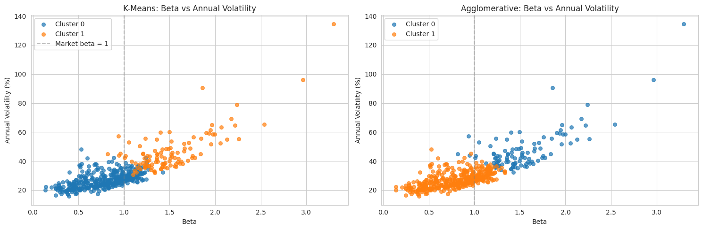
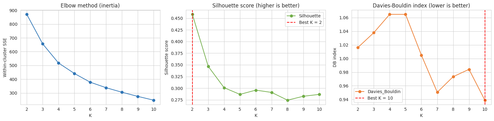
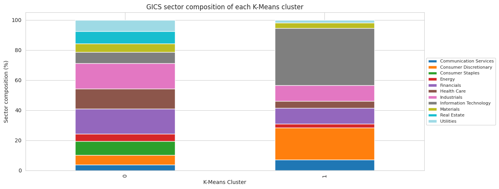

# S&P 500 Stock Segmentation: Risk–Return Clustering

[](https://colab.research.google.com/github/OsmanAks22/SP500-Clustering/blob/main/SP500_Clustering_Analysis.ipynb)

Groups the constituents of the S&P 500 by three risk–return measures (mean daily return, beta and annual volatility) using Ward agglomerative clustering and K-Means, over 1 January 2022 to 1 January 2025.

> Coursework 2 for **7BUIS010W Data Warehousing & Business Intelligence**, MSc Data Science & Analytics, University of Westminster (group coursework, submitted 28 April 2026). This repository contains Tasks A and B (data, metrics and clustering), written by Osman Akkese. Task C (cluster review and data-mart design) was written by a teammate in the group report and is not part of this repository.

**Tech stack:** Python · pandas · NumPy · yfinance · scikit-learn (K-Means, Ward agglomerative, silhouette, Davies–Bouldin) · SciPy · matplotlib · seaborn

## Problem

Can a few market-risk measures split the index into groups that mean something to an investor? The notebook builds the measures from raw prices, prepares them for distance-based clustering, chooses the number of clusters with several diagnostics, and checks whether two different algorithms agree.

## Data

| Source | What | Notes |
|---|---|---|
| Wikipedia, *List of S&P 500 companies* | 503 constituents with GICS sector | Fetched with `requests` and a browser user agent, because Wikipedia returns HTTP 403 to the default pandas client |
| Yahoo Finance via `yfinance` | Daily adjusted prices, 2022-01-01 to 2025-01-01 | One threaded batch download |
| Yahoo Finance via `YahooFinancials` | S&P 500 index (`^GSPC`) as the beta benchmark | Falls back to `yfinance` when `YahooFinancials` returns no data (see *Known issues*) |

Cleaning drops tickers with no data and tickers with more than 10% missing days, then forward-fills short gaps. In the original run this kept **496 of 503 stocks over 742 trading days**.

[`data/sp500_metrics_2022_2024.csv`](data/sp500_metrics_2022_2024.csv) is the metric table from that original run (496 stocks × mean daily return, beta, annual volatility, sector). It is included because the live inputs change over time (see *Reproducing*).

## Method

1. **Metrics.** Daily return `R = P_t / P_{t-1} − 1`; beta `β = ρ(stock, index) · σ_stock / σ_index`; annual volatility `σ_daily · √252`.
2. **Preparation.** Skew check, winsorising at the 1st and 99th percentiles (annual-volatility skew falls from 2.884 to 1.375), then `StandardScaler`.
3. **Agglomerative clustering** with Ward linkage. N is chosen from the dendrogram and the silhouette score for N = 2…8.
4. **K-Means** with `n_init=20` and `random_state=42`. K is chosen from the elbow, silhouette and Davies–Bouldin index for K = 2…10.
5. **Comparison.** Cross-tabulation of the two label sets, centroids in original units, and sector composition per cluster.

## Results

All figures below come from the notebook's saved outputs of the original run. The method-agreement figure comes from Table 1 of the group report, and I reproduced it on 14 October 2026 by re-clustering `data/sp500_metrics_2022_2024.csv`.

| | Agglomerative (Ward) | K-Means |
|---|---|---|
| Chosen number of clusters | N = 2 | K = 2 |
| Silhouette at the chosen size | 0.4710 | 0.4582 |
| Cluster sizes | 104 / 392 | 113 / 383 |

- The silhouette peaks at 2 clusters for both methods. The Davies–Bouldin index alone prefers K = 10 (0.9389), which the analysis treats as over-segmentation.
- **The two methods agree on 96.6% of stocks** (479 of 496):

  | | Ward high-risk (104) | Ward defensive (392) |
  |---|---:|---:|
  | K-Means high-risk (113) | 100 | 13 |
  | K-Means defensive (383) | 4 | 379 |

- **K-Means cluster profiles** (cluster means):

  | Cluster | Stocks | Mean daily return | Beta | Annual volatility |
  |---|---:|---:|---:|---:|
  | High-risk growth | 113 | 0.0009 | 1.51 | 46.4% |
  | Defensive core | 383 | 0.0004 | 0.78 | 27.0% |

- **Re-run check (20 October 2026).** `scripts/reproduce_from_snapshot.py` re-clusters the saved metric table offline and reproduces the silhouettes (0.4582 / 0.4710), the cluster sizes and the 479/496 agreement exactly. A full live re-run of the notebook on the same date kept 492 stocks; both methods again chose 2 clusters (silhouettes 0.4785 / 0.4745) and agreed on 92.3% of stocks (454 of 492).
- The highest betas in the sample are Carvana (3.299), Coinbase (2.965) and NVIDIA (2.260). The lowest are General Mills (0.138) and Campbell's (0.142).

<p align="center">
  
</p>
<p align="center">
  
</p>
<p align="center">
  
</p>

More figures are in [`figures/`](figures/): the metric distributions, pair plot, dendrogram, agglomerative silhouette curve and 3-D cluster view.

## Reproducing

**Offline, from the saved metric table (seconds, no network):**

```bash
pip install pandas scikit-learn
python scripts/reproduce_from_snapshot.py
```

**Colab:** use the badge above and run all cells.

**Locally (Python 3.12):**

```bash
python -m venv .venv
source .venv/bin/activate
pip install -r requirements.txt
jupyter notebook SP500_Clustering_Analysis.ipynb
```

The notebook downloads its inputs live, so a fresh run will not match the saved outputs exactly. The constituent list on Wikipedia changes, and newer constituents have no 2022 price history. In a re-run on 14 October 2026, 492 stocks survived cleaning; K-Means and Ward still chose 2 clusters, with silhouettes of 0.4785 and 0.4745. The algorithm choices held, while the stock count and scores moved with the data.

## Known issues

- **`YahooFinancials` no longer returns `^GSPC` history.** In October 2026 it returns an empty result, which made the original cell fail with `KeyError: 'prices'`. The cell now falls back to `yfinance` for the same series and leaves the original path unchanged when it works. The saved outputs are from the original `YahooFinancials` run.
- **The report and the notebook differ slightly.** The group report quotes silhouettes of 0.4565 (K-Means) and 0.4699 (Ward), a minimum Davies–Bouldin of 0.927, an annual-volatility skew "above three" and 752 trading days. The notebook's saved outputs, which this README follows, show 0.4582, 0.4710, 0.9389, 2.884 and 742.
- **The cleaning step shortens the window for every stock.** Forward-filling and then dropping rows that still contain a gap removes the first 11 trading days (before a late-listed constituent's first price), so all metrics use 19 January 2022 to 31 December 2024 (742 price days, 741 returns) rather than the full 753 days.
- **No star-schema data mart in this repository.** The data-mart design (fact and dimension tables) was a written sketch in Task C of the group report. No SQL implementation exists.

## Limitations

- **Survivorship bias.** The constituent list is today's, applied to 2022–2024 prices, so companies that left the index during the window are missing.
- **In-sample and descriptive.** Betas and volatilities are measured on the same window that is clustered; nothing is forecast or validated out of sample.
- **Three features.** Mean daily return, beta and annual volatility are strongly correlated (beta and volatility especially), so the two-cluster split is largely a high-risk / low-risk cut.
- **"Centroids in original units"** are inverse-transformed from the winsorised data, so they differ slightly from the raw cluster means quoted above (for example, beta 1.49 against 1.51).

## Repository structure

```
SP500_Clustering_Analysis.ipynb   the analysis, with outputs from the original run
data/sp500_metrics_2022_2024.csv  metric table from the original run (496 stocks)
figures/                          figures exported from the saved notebook outputs
scripts/reproduce_from_snapshot.py  offline re-clustering of the saved metric table
requirements.txt                  package versions used for the October 2026 re-run
```
